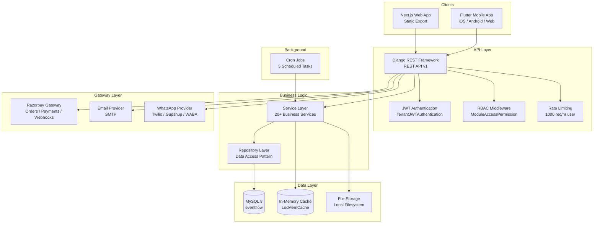
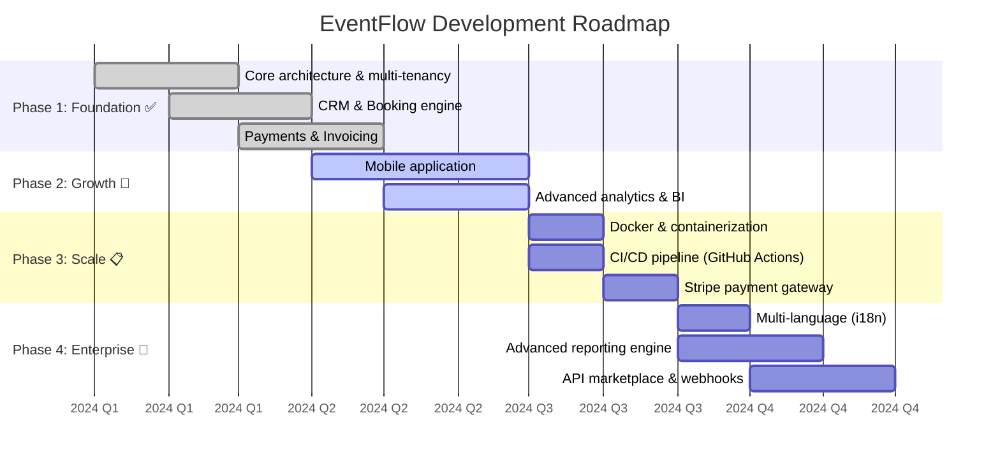

<div align="center">
  <br/>
  <h1>🎯 EventFlow</h1>
  <h3>Enterprise-Grade Multi-Tenant Event Management SaaS Platform</h3>
  <br/>
</div>

<p align="center">
  
  
  
  
  
  
  
  
  
  
  
</p>

<p align="center">
  <a href="#"></a>
  <a href="#"></a>
  <a href="#"></a>
  <a href="#"></a>
  <a href="#"></a>
  <a href="#"></a>
  <a href="#"></a>
</p>

<br/>

---

## 📋 Table of Contents

- [About EventFlow](#-about-eventflow)
- [Features](#-features)
- [Tech Stack](#-tech-stack)
- [Architecture](#-architecture)
- [Folder Structure](#-folder-structure)
- [Database Design](#-database-design)
- [API Overview](#-api-overview)
- [Authentication & Authorization](#-authentication--authorization)
- [User Roles & Permissions](#-user-roles--permissions)
- [Installation](#-installation)
- [Environment Variables](#-environment-variables)
- [Production Deployment](#-production-deployment)
- [Testing](#-testing)
- [Project Workflow](#-project-workflow)
- [Security](#-security)
- [Future Roadmap](#-future-roadmap)
- [Contributing](#-contributing)
- [License](#-license)

---

## 🚀 About EventFlow

EventFlow is a **production-grade, multi-tenant SaaS platform** purpose-built for event management businesses. It replaces spreadsheets, fragmented tools, and manual workflows with a unified platform that manages the entire event lifecycle — from lead capture and booking to payments, vendor coordination, and post-event reporting.

**Built for:** Banquet halls, marriage lawns, convention centers, party planners, and event management companies.

**Key differentiators:**
- **True multi-tenant isolation** — each business operates in a completely isolated data silo
- **Granular RBAC** — 6 user roles with per-module, per-action permissions
- **Omnichannel notifications** — in-app, email (SMTP), and WhatsApp (Twilio/Gupshup/Business API)
- **Mobile-first** — companion Flutter app for on-the-go management
- **Offline-capable** — mobile app with Hive local storage
- **Payment gateway ready** — Razorpay integration with webhook verification

---

## ✨ Features

<details open>
<summary><strong>📊 Core Platform</strong></summary>
<br/>

| Feature | Description |
|---------|-------------|
| **Multi-Tenant Architecture** | Fully isolated data per tenant with automatic scoping |
| **Role-Based Access Control** | 6 roles with per-module, per-action granular permissions |
| **JWT Authentication** | Token-based auth with refresh rotation and blacklisting |
| **Subscription Management** | Tiered plans (Starter/Professional/Enterprise) with usage limits |
| **Audit Logging** | Complete change history across all entities |
| **Dashboard** | Real-time KPIs, revenue charts, booking trends, lead conversion |
| **Reporting** | 10+ report types with CSV, Excel, and PDF export |

</details>

<details>
<summary><strong>👥 CRM & Sales</strong></summary>
<br/>

| Feature | Description |
|---------|-------------|
| **Lead Management** | Track leads from enquiry to conversion with follow-up scheduling |
| **Customer Management** | Centralized customer profiles with merge capability |
| **Quotation Engine** | Generate, send, accept/reject quotations with itemized pricing |
| **Lead Sources** | Track source attribution (website, Google, Facebook, Instagram, WhatsApp, referral) |
| **Event Type Categorization** | Wedding, Reception, Birthday, Corporate, Conference, etc. |

</details>

<details>
<summary><strong>📅 Event Operations</strong></summary>
<br/>

| Feature | Description |
|---------|-------------|
| **Venue Management** | Multiple venues with capacity, pricing tiers, images |
| **Package Management** | Event packages with itemized components and pricing |
| **Booking Management** | Full lifecycle: Draft → Tentative → Confirmed → In Progress → Completed |
| **Booking Calendar** | Visual calendar view of all bookings |
| **Booking Timeline** | Status change history with timestamps |
| **Contract Management** | Generate, sign, PDF export, cancel contracts |
| **Task Management** | Assign tasks to staff with priority levels and due dates |
| **Staff Management** | Staff profiles with designation and status tracking |

</details>

<details>
<summary><strong>💰 Financial</strong></summary>
<br/>

| Feature | Description |
|---------|-------------|
| **Payment Processing** | Multiple methods: Cash, UPI, Bank Transfer, Cheque, Card, Razorpay |
| **Razorpay Integration** | Order creation, payment capture, refunds, webhook verification |
| **Invoice Generation** | Auto-numbered invoices with PDF export and email delivery |
| **Expense Tracking** | Categorize and track operational expenses |
| **Outstanding Tracking** | Monitor overdue payments per booking |
| **GST Support** | Configurable GST rates and invoice formatting |

</details>

<details>
<summary><strong>🔗 Vendor & Inventory</strong></summary>
<br/>

| Feature | Description |
|---------|-------------|
| **Vendor Management** | Caterers, decorators, photographers, DJs, security, etc. |
| **Vendor Assignment** | Assign vendors to bookings with agreed amounts |
| **Inventory Management** | Track chairs, tables, stages, lights, generators, sound systems |
| **Inventory Allocation** | Allocate and release inventory per booking |
| **Availability Tracking** | Real-time available quantity monitoring |

</details>

<details>
<summary><strong>📱 Mobile App</strong></summary>
<br/>

| Feature | Description |
|---------|-------------|
| **Cross-Platform** | iOS, Android, and Web from a single Flutter codebase |
| **BLoC Pattern** | Reactive state management with BLoC architecture |
| **Offline Support** | Hive local storage with connectivity-aware caching |
| **Push Notifications** | Firebase Cloud Messaging integration |
| **Biometric Auth** | Fingerprint/Face ID support |
| **Razorpay Mobile SDK** | In-app payments |
| **Responsive UI** | Adaptive layouts for phones and tablets |

</details>

<details>
<summary><strong>🔔 Notifications</strong></summary>
<br/>

| Feature | Description |
|---------|-------------|
| **In-App Notifications** | Real-time notification feed in dashboard |
| **Email Notifications** | SMTP-based email delivery with configurable templates |
| **WhatsApp Notifications** | Multi-provider support (Twilio, Gupshup, WhatsApp Business API) |
| **Event Reminders** | Automatic reminders before scheduled events |
| **Payment Alerts** | Notifications on payment receipt and overdue payments |
| **Subscription Reminders** | Expiry and renewal notifications |

</details>

---

## 🛠 Tech Stack

### Backend

| Technology | Purpose |
|------------|---------|
| **Python 3.14+** | Runtime |
| **Django 4.2.16** | Web framework |
| **Django REST Framework 3.15.2** | REST API toolkit |
| **SimpleJWT 5.3.1** | JWT authentication with token blacklisting |
| **MySQL 8+** | Primary database |
| **ReportLab 4.2** | PDF generation for invoices, receipts, contracts |
| **OpenPyXL 3.1** | Excel report export |
| **Django Filter 24.3** | Query parameter filtering |
| **WhiteNoise 6.7** | Static file serving |
| **Gunicorn 21.2** | Production WSGI server |
| **Uvicorn 0.27** | ASGI server support |
| **Python Decouple 3.8** | Environment variable management |

### Frontend

| Technology | Purpose |
|------------|---------|
| **Next.js 14.2** | React framework (`next build` + `next start`) |
| **React 18.3** | UI library |
| **TypeScript 5.5** | Type safety |
| **TailwindCSS 3.4** | Utility-first CSS |
| **shadcn/ui** | Component library (25+ components) |
| **TanStack Query 5.50** | Server state management |
| **Axios** | HTTP client with interceptor-based auth |
| **React Hook Form + Zod** | Form validation |
| **Recharts** | Charts and data visualization |
| **Framer Motion** | Animations |
| **Lucide React** | Icon library |
| **next-themes** | Dark/light mode |

### Mobile

| Technology | Purpose |
|------------|---------|
| **Flutter 3.12** | Cross-platform framework |
| **Dart 3** | Programming language |
| **BLoC** | State management |
| **Dio** | HTTP client |
| **Go Router** | Declarative routing |
| **Hive** | Local storage |
| **Firebase Messaging** | Push notifications |
| **Razorpay Flutter** | Mobile payments |
| **fl_chart** | Charts |
| **get_it** | Dependency injection |

---

## 🏗 Architecture



### Deployment Topology

```
yourdomain.com         → Next.js SSR (`next start` on 127.0.0.1:3000, proxied by nginx)
api.yourdomain.com     → Django DRF API (gunicorn on 127.0.0.1:8000, proxied by nginx)
media.yourdomain.com   → Allowlisted media only (tenants/logos, venues, …); rest → 404
```

---

## 📁 Folder Structure

```
├── .env.example              # Environment template
├── .gitignore                # Git exclusion rules
├── .htaccess                 # Apache root config (API proxy + SPA fallback)
├── api.htaccess              # API subdomain Passenger WSGI config
├── media.htaccess            # Media directory access controls
├── cron-jobs.sh              # 5 scheduled cron job scripts
├── DEPLOYMENT.md             # Production deployment guide
├── Docs/                     # Complete project documentation
│   ├── API SPECIFICATION DOCUMENT.md
│   ├── DATABASE DESIGN DOCUMENT.md
│   ├── SAAS ARCHITECTURE & SYSTEM DESIGN DOCUMENT.md
│   ├── ROLE BASED ACCESS CONTROL (RBAC).md
│   ├── UI UX SPECIFICATION DOCUMENT.md
│   └── ...
│
├── backend/                  # Django DRF API (development)
│   ├── manage.py
│   ├── passenger_wsgi.py     # cPanel WSGI entry point
│   ├── setup.py
│   ├── requirements/         # Split environment requirements
│   │   ├── base.txt
│   │   ├── development.txt
│   │   └── production.txt
│   ├── config/               # Django project configuration
│   │   ├── settings/         # Base / Dev / Prod / Test
│   │   ├── urls.py           # Root URL configuration
│   │   ├── api_router.py     # DRF router + auth endpoints + webhook
│   │   ├── asgi.py / wsgi.py
│   │   └── passenger_wsgi.py
│   ├── core/                 # Shared infrastructure
│   │   ├── authentication.py # Tenant-scoped JWT auth
│   │   ├── base_models.py    # BaseModel + TenantBaseModel
│   │   ├── choices.py        # All enum/text choices
│   │   ├── constants.py      # System constants
│   │   ├── exceptions.py     # Custom exception handler
│   │   ├── pagination.py     # Standard pagination class
│   │   ├── responses.py      # Standardized API responses
│   │   └── management/commands/  # Core management commands
│   ├── middleware/            # Request processing pipeline
│   │   ├── tenant.py         # Tenant scoping
│   │   ├── subscription.py   # Subscription gate
│   │   ├── audit.py          # Audit logging
│   │   └── request_context.py
│   ├── permissions/          # RBAC system
│   │   ├── roles.py          # Role-based permission classes
│   │   ├── module_access.py  # Granular module+action permissions
│   │   └── feature_limits.py # Subscription feature limits
│   ├── apps/                 # 22 Django applications
│   │   ├── tenants/          # Multi-tenant management
│   │   ├── authentication/   # JWT login, register, password reset
│   │   ├── users/            # Users, sessions, roles
│   │   ├── customers/        # Customer CRM
│   │   ├── leads/            # Lead tracking + quotations
│   │   ├── venues/           # Venue catalog + images
│   │   ├── packages/         # Event package management
│   │   ├── bookings/         # Booking lifecycle
│   │   ├── payments/         # Payment processing + Razorpay
│   │   ├── invoices/         # Invoice generation + PDF
│   │   ├── vendors/          # Vendor management
│   │   ├── inventory/        # Inventory + allocation
│   │   ├── staff/            # Staff management
│   │   ├── tasks/            # Task assignment
│   │   ├── expenses/         # Expense tracking
│   │   ├── subscriptions/    # Plans, subscriptions, credits
│   │   ├── notifications/    # Multi-channel notifications
│   │   ├── audit_logs/       # Change audit trail
│   │   ├── reports/          # Reporting engine
│   │   ├── settings/         # All settings categories
│   │   ├── contracts/        # Contract management
│   │   └── dashboard/        # Dashboard aggregation
│   ├── services/             # 20+ Business logic services
│   ├── repositories/         # 16 Data access repositories
│   ├── gateway/              # External integrations
│   │   ├── payments/         # Razorpay + Manual gateways
│   │   └── messaging/        # Email + WhatsApp providers
│   ├── utils/                # Utilities (GST, dates, money, etc.)
│   ├── reports/              # PDF, CSV, Excel generators
│   ├── tests/                # 34 test files
│   │   ├── api/              # 18 API endpoint test suites
│   │   ├── unit/             # 11 unit test suites
│   │   └── integration/      # 6 integration test suites
│   └── management/commands/  # Production management commands
│
├── backend-build/            # Production-deployed backend variant
│   └── staticfiles/          # Collected Django static assets
│
├── frontend/                 # Next.js web application
│   ├── package.json
│   ├── next.config.mjs       # Build config (validates NEXT_PUBLIC_API_URL)
│   ├── tailwind.config.ts    # Custom theme configuration
│   ├── app/                  # Next.js 14 App Router pages
│   │   ├── layout.tsx        # Root layout with providers
│   │   ├── page.tsx          # Landing page
│   │   ├── (auth)/           # Login, forgot/reset password
│   │   ├── (marketing)/      # 20+ marketing pages
│   │   └── (dashboard)/      # 30+ dashboard pages
│   ├── components/
│   │   ├── ui/               # 25 shadcn/ui components
│   │   ├── common/           # 10 shared components
│   │   ├── layout/           # Sidebar, TopNav, MobileNav
│   │   ├── landing/          # 10 landing page sections
│   │   └── marketing/        # Marketing page components
│   ├── hooks/                # 18 React Query hooks
│   ├── services/             # 20 API service modules
│   ├── stores/               # Auth context provider
│   ├── lib/                  # API client, utils, constants, theme
│   └── types/                # TypeScript type definitions
│
└── mobile_app/               # Flutter cross-platform app
    ├── pubspec.yaml
    ├── lib/
    │   ├── main.dart
    │   ├── injector.dart     # Dependency injection
    │   ├── core/             # API client, theme, widgets, storage
    │   └── features/         # 8 feature modules with BLoC
    ├── android/              # Android platform config
    ├── ios/                  # iOS platform config
    └── web/                  # Web platform config
```

---

## 💾 Database Design

The database consists of **30+ tables** organized by domain.

### Core Tables

| Table | Purpose | Key Fields |
|-------|---------|------------|
| `tenants` | Multi-tenant organizations | business_name, email, subscription_plan, status |
| `users` | User accounts with roles | email, mobile, role (6 types), tenant FK |
| `user_sessions` | Active JWT session tracking | access_token, refresh_token, expires_at |
| `password_reset_codes` | Secure password reset flow | code (hashed), is_used |
| `subscription_plans` | SaaS pricing tiers | monthly_price, max_users, max_venues, features JSON |
| `subscriptions` | Tenant subscription states | tenant, plan, billing_cycle, status |

### Business Tables

| Table | Purpose | Key Fields |
|-------|---------|------------|
| `customers` | Customer profiles | name, mobile, email (unique per tenant) |
| `leads` | Sales lead pipeline | source, event_type, expected_date, status |
| `followups` | Lead follow-up tracking | followup_date, notes, next_action |
| `quotations` | Price quotes | venue, package, subtotal, tax, total, status |
| `quotation_items` | Itemized quote lines | item_name, quantity, unit_price |
| `venues` | Event venues | type, capacity, weekday/weekend/peak pricing |
| `venue_images` | Venue photo gallery | image, display_order |
| `packages` | Event packages | base_price, status |
| `package_items` | Package line items | item_name, quantity, unit_price |
| `bookings` | Core booking records | booking_number (unique), event_date, guest_count, total_amount, status |
| `booking_history` | Booking status timeline | old_status, new_status, remarks |

### Financial Tables

| Table | Purpose | Key Fields |
|-------|---------|------------|
| `payments` | Payment records | amount, method (6 types), type (payment/refund), reference |
| `invoices` | Invoices with PDF | invoice_number (unique), subtotal, tax, total, pdf_file |
| `expenses` | Operational expenses | category, amount, expense_date |

### Operational Tables

| Table | Purpose | Key Fields |
|-------|---------|------------|
| `vendors` | Vendor directory | type (caterer, decorator, DJ, etc.), status |
| `booking_vendors` | Booking-vendor assignments | agreed_amount, status |
| `inventory_items` | Inventory catalog | category, total/available quantity |
| `inventory_allocations` | Per-booking allocations | allocated_quantity |
| `staff` | Staff directory | designation, joining_date, status |
| `tasks` | Task management | priority (4 levels), status (4 states), due_date |
| `contracts` | Legal agreements | contract_number (unique), content, signed_date, pdf |

### Configuration Tables

| Table | Purpose | Key Fields |
|-------|---------|------------|
| `tenant_settings` | Per-tenant configuration | currency, timezone, gst_rate, invoice_prefix |
| `payment_gateway_settings` | Encrypted gateway keys | gateway, api_key, api_secret, webhook_secret |
| `email_settings` | SMTP configuration | smtp_host, port, username, encrypted password |
| `whatsapp_settings` | WhatsApp provider config | provider, api_key, phone_number_id |
| `invoice_settings` | Invoice format config | prefix, template, due_days, gst_enabled |
| `booking_settings` | Booking rules config | tentative_validity, buffer_days, cancellation_policy |
| `notification_settings` | Notification preferences | per-event-type toggles, reminder_hours |
| `security_settings` | Security configuration | session_timeout, max_login_attempts, 2fa |
| `branding_settings` | White-label branding | primary_color, logo, favicon, custom_domain |

---

## 🌐 API Overview

All endpoints are versioned under `/api/v1/`.

### Authentication

| Method | Endpoint | Purpose |
|--------|----------|---------|
| POST | `/api/v1/auth/login/` | Login with email or mobile |
| POST | `/api/v1/auth/refresh/` | Refresh access token |
| POST | `/api/v1/auth/logout/` | Blacklist refresh token |
| POST | `/api/v1/auth/forgot-password/` | Request password reset code |
| POST | `/api/v1/auth/reset-password/` | Reset password with code |
| POST | `/api/v1/auth/change-password/` | Change password (authenticated) |
| GET/PUT | `/api/v1/profile/` | View/update profile |

### Business Endpoints (all CRUD + custom actions)

| Endpoint Group | Resources |
|----------------|-----------|
| `tenants/` | Tenant CRUD |
| `users/` | User CRUD, activate/deactivate |
| `customers/` | Customer CRUD, merge |
| `leads/` | Lead CRUD, convert, followups |
| `quotations/` | Quotation CRUD, send, accept, reject |
| `venues/` | Venue CRUD, images |
| `packages/` | Package CRUD |
| `bookings/` | Booking CRUD, cancel, confirm, mark_in_progress, mark_completed, timeline, calendar, outstanding |
| `payments/` | Payment CRUD, refund, receipt, receipt_pdf, outstanding, summary |
| `invoices/` | Invoice CRUD, generate, pdf, download, email |
| `vendors/` | Vendor CRUD, assign |
| `inventory/` | Inventory CRUD, allocate, release |
| `staff/` | Staff CRUD |
| `tasks/` | Task CRUD, update status |
| `expenses/` | Expense CRUD |
| `subscriptions/` | Plans, current, history, renew |
| `notifications/` | List, mark read |
| `audit-logs/` | List, filter |
| `reports/` | Financial, operational, revenue, bookings, payments, occupancy, leads, vendors, inventory, outstanding, monthly_growth, export |
| `settings/` | All settings categories |
| `contracts/` | Contract CRUD, generate, pdf, sign, cancel |
| `dashboard/summary/` | Aggregated dashboard KPIs |

### Standard Response Format

```json
{
  "success": true,
  "data": { ... },
  "message": "Operation completed successfully",
  "errors": null
}
```

### Paginated Response

```json
{
  "count": 150,
  "next": "http://api.example.com/api/v1/bookings/?page=3",
  "previous": "http://api.example.com/api/v1/bookings/?page=1",
  "results": [ ... ]
}
```

### Webhook

| Method | Endpoint | Purpose |
|--------|----------|---------|
| POST | `/api/v1/payments/webhook/razorpay/` | Razorpay payment captured events |

### Monitoring

| Method | Endpoint | Purpose |
|--------|----------|---------|
| GET | `/health/` | Application health |
| GET | `/ready/` | Readiness probe |
| GET | `/live/` | Liveness probe |
| GET | `/admin/` | Django admin interface |

---

## 🔐 Authentication & Authorization

### JWT Flow

```
User → Login (email/mobile + password)
  ↓
Server validates credentials via EmailOrMobileBackend
  ↓
Returns access_token (60 min) + refresh_token (24 hours)
  ↓
Client stores tokens, sends Bearer token in Authorization header
  ↓
TenantJWTAuthentication validates JWT + sets request.tenant
  ↓
Token refresh on 401 → automatic retry with new token
```

### Security Features

- **Token blacklisting** on logout and rotation
- **Rate limiting**: 5 login attempts/minute, 1000 requests/hour per user
- **Brute force protection**: configurable max login attempts with lockout
- **Session management**: track all active sessions per user
- **Password validation**: minimum length, common password check, numeric check

---

## 👥 User Roles & Permissions

### Role Hierarchy

| Role | Level | Description |
|------|-------|-------------|
| `SUPER_ADMIN` | System-wide | Full access across all tenants |
| `OWNER` | Tenant owner | Complete access to their tenant |
| `MANAGER` | Operations | Day-to-day event and venue management |
| `ACCOUNTANT` | Finance | Payments, invoices, expenses, reports |
| `STAFF` | Frontline | View bookings, update tasks, mark attendance |
| `CUSTOMER` | Client | Limited self-service access |

### Permission Model

Permissions are defined in `MODULE_PERMISSIONS` as a dictionary mapping:

```
Module → Action → [Allowed Roles]
```

Each API view checks `ModuleAccessPermission` which:
1. Reads the `module_name` attribute from the view
2. Maps the HTTP method/action to the permissions dictionary
3. Verifies the user's role is in the allowed list

**Example — Bookings module:**
```python
"bookings": {
    "create": [SUPER_ADMIN, OWNER, MANAGER],
    "list": [SUPER_ADMIN, OWNER, MANAGER, ACCOUNTANT, STAFF],
    "cancel": [SUPER_ADMIN, OWNER, MANAGER],
    "mark_completed": [SUPER_ADMIN, OWNER, MANAGER, STAFF],
    "destroy": [SUPER_ADMIN, OWNER],
}
```

---

## 📦 Installation

### Prerequisites

- Python 3.14+
- Node.js 18+
- Flutter 3.12+ (for mobile)
- MySQL 8+
- Redis (optional, for caching)

### Backend Setup

```bash
# Clone the repository
git clone https://github.com/nadeemmx/EventFlow.git
cd EventFlow

# Create virtual environment
python -m venv .venv
source .venv/bin/activate  # Linux/Mac
# .venv\Scripts\activate   # Windows

# Install dependencies
pip install -r backend/requirements/development.txt

# Configure environment
cp .env.example .env
# Edit .env with your database credentials

# Run migrations
cd backend
python manage.py migrate

# Seed demo data
python manage.py seed_demo_data

# Start development server
python manage.py runserver
```

### Frontend Setup

```bash
cd frontend
npm install
cp .env.example .env.local
# Edit .env.local with your API URL
npm run dev
```

### Mobile Setup

```bash
cd mobile_app
flutter pub get
cp .env.example .env
# Edit .env with your API URL and keys
flutter run
```

---

## 🔧 Environment Variables

### Root `.env` (Backend)

| Variable | Required | Default | Description |
|----------|----------|---------|-------------|
| `DJANGO_SECRET_KEY` | Yes | — | 50+ char random secret key |
| `DJANGO_DEBUG` | No | `False` | Debug mode (True for development) |
| `DJANGO_ALLOWED_HOSTS` | No | `localhost,127.0.0.1` | Comma-separated allowed hosts |
| `DB_NAME` | No | `eventflow` | MySQL database name |
| `DB_USER` | Yes | — | MySQL user |
| `DB_PASSWORD` | Yes | — | MySQL password |
| `DB_HOST` | No | `127.0.0.1` | MySQL host |
| `DB_PORT` | No | `3306` | MySQL port |
| `CORS_ALLOWED_ORIGINS` | No | `http://localhost:3000` | Allowed CORS origins |
| `JWT_ACCESS_TOKEN_LIFETIME` | No | `60` | Access token expiry (minutes) |
| `JWT_REFRESH_TOKEN_LIFETIME` | No | `1440` | Refresh token expiry (minutes) |
| `EMAIL_HOST` | No | — | SMTP server host |
| `EMAIL_PORT` | No | `587` | SMTP port |
| `EMAIL_HOST_USER` | No | — | SMTP username |
| `EMAIL_HOST_PASSWORD` | No | — | SMTP password |
| `EMAIL_USE_TLS` | No | `True` | SMTP TLS flag |
| `DEFAULT_FROM_EMAIL` | No | `noreply@eventflow.com` | Default sender email |
| `SENTRY_DSN` | No | — | Sentry error tracking DSN |

### Frontend `.env.local`

| Variable | Required | Default | Description |
|----------|----------|---------|-------------|
| `NEXT_PUBLIC_API_URL` | Yes | `http://localhost:8000/api/v1` | Backend API base URL |
| `NEXT_PUBLIC_APP_URL` | Yes | `http://localhost:3000` | Frontend application URL |

### Mobile `.env`

| Variable | Required | Description |
|----------|----------|-------------|
| `API_BASE_URL` | Yes | Backend API base URL |
| `RAZORPAY_KEY_ID` | Yes | Razorpay payment gateway key |
| `FIREBASE_API_KEY` | Yes | Firebase Cloud Messaging key |

---

## 🚢 Production Deployment

### Shared hosting (cPanel)

Historical cPanel/Passenger notes; the supported path is systemd + nginx (below).

```
yourdomain.com         → Next.js SSR (`next start`, systemd eventflow-frontend.service)
api.yourdomain.com     → Django DRF API (gunicorn, systemd eventflow.service)
media.yourdomain.com   → Allowlisted media only (nginx location rules)
```

```bash
# 1. Database
# Create MySQL database via phpMyAdmin

# 2. Backend (via cPanel Python App)
cd backend
python -m venv .venv
source .venv/bin/activate
pip install -r requirements/production.txt
python manage.py migrate
python manage.py collectstatic
python manage.py seed_demo_data

# 3. Frontend
cd frontend
npm ci
# NEXT_PUBLIC_API_URL must be set (frontend/.env.production) or the build fails
npm run build
# Served by `next start` (systemd unit eventflow-frontend.service),
# proxied by nginx — there is no static `out/` upload step.

# 4. Configure cron jobs (cPanel)
# See cron-jobs.sh for all 5 scheduled tasks
```

### VPS (recommended)

See `DEPLOYMENT.md` and `deploy/deploy_production.sh` for the supported
systemd + nginx path (backend sync, `next build`/`next start`, media
allowlist, health checks on `127.0.0.1:8000` / `127.0.0.1:3000`).

```bash
# From the repo root on the VPS (requires sudoers entries printed by the script)
bash deploy/deploy_production.sh
```

### Docker (Future)

```dockerfile
# Dockerfile planned for containerized deployment
# See roadmap
```

---

## 🧪 Testing

### Backend Tests

```bash
cd backend
pytest                          # Run all tests
pytest tests/api/               # API tests only
pytest tests/unit/              # Unit tests only
pytest tests/integration/       # Integration tests only
pytest --cov=. --cov-report=html  # Coverage report
```

**Test Coverage:**
- **34 test files** across API, unit, and integration tiers
- Factory Boy fixtures for all models
- In-memory SQLite for fast test execution
- MD5 password hasher for performance

### Frontend Testing

```bash
cd frontend
npm run lint
```

### Mobile Testing

```bash
cd mobile_app
flutter test
flutter analyze
```

---

## 🔄 Project Workflow

### End-to-End Business Flow

```
1. LEAD CAPTURE
   └── Lead arrives via website, social media, walk-in, or referral
   └── Staff creates lead record with event details
   └── Follow-ups scheduled to nurture the lead
   
2. QUOTATION
   └── Generate itemized quotation with venue + package pricing
   └── Send to customer via email/WhatsApp
   └── Track status: Sent → Accepted → Rejected
   
3. BOOKING
   └── Convert accepted quotation to booking
   └── Collect advance payment
   └── Booking status: Draft → Tentative → Confirmed
   
4. EVENT EXECUTION
   └── Assign vendors (caterer, decorator, photographer, etc.)
   └── Allocate inventory (chairs, tables, sound system, etc.)
   └── Assign staff tasks with priorities and deadlines
   └── Status: In Progress
   
5. FINANCIAL CLOSURE
   └── Record payments (partial/full) with multiple payment methods
   └── Generate GST-compliant invoice
   └── Generate payment receipt PDF
   └── Handle refunds if applicable
   
6. POST-EVENT
   └── Mark booking as Completed
   └── Generate contract PDF
   └── Track expenses against revenue
   └── Run reports and analytics
```

### Scheduled Jobs

| Cron Job | Schedule | Purpose |
|----------|----------|---------|
| `expire_tentative_bookings` | Every 30 min | Auto-expire tentative bookings after validity period |
| `send_subscription_reminders` | Daily | Notify tenants of upcoming subscription expiry |
| `send_event_reminders` | Daily | Send 24-hour event reminders |
| `update_overdue_payments` | Daily | Mark overdue payments and send alerts |
| `cleanup_old_logs` | Weekly | Rotate and archive audit log entries |

---

## 🛡 Security

| Measure | Implementation |
|---------|---------------|
| **JWT Authentication** | SimpleJWT with access/refresh token rotation |
| **Token Blacklisting** | Revoked tokens stored in blacklist on logout |
| **Tenant Isolation** | All queries scoped via `TenantBaseModel` and `TenantMiddleware` |
| **RBAC** | 6 roles with per-module, per-action authorization |
| **Input Validation** | DRF serializers + custom validators |
| **Rate Limiting** | Anon: 100/hr, User: 1000/hr, Login: 5/min |
| **Brute Force Protection** | Configurable max attempts with temporary lockout |
| **Password Validation** | Minimum length, common password, numeric checks |
| **CORS** | Whitelisted origins only |
| **CSRF** | Django CSRF protection for session-based views |
| **HSTS** | 1 year, include subdomains, preload (production) |
| **Secure Cookies** | `SESSION_COOKIE_SECURE`, `CSRF_COOKIE_SECURE` (production) |
| **Content Security** | `X-Content-Type-Options: nosniff`, `X-Frame-Options: DENY` |
| **SQL Injection** | Django ORM parameterized queries throughout |
| **XSS Prevention** | DRF JSON renderer, template escaping |
| **Encrypted Fields** | Payment gateway keys encrypted at rest |
| **Audit Trail** | All CRUD operations logged with user, IP, before/after data |

---

## 📈 Future Roadmap



### Planned Enhancements

- [ ] **Docker Compose** setup for one-command local development
- [ ] **GitHub Actions** CI/CD pipeline with automated testing and deployment
- [ ] **Stripe** payment gateway integration
- [ ] **Redis** caching layer for improved performance
- [ ] **Internationalization** (i18n) for multi-language support
- [ ] **WebSocket** real-time notifications
- [ ] **S3/CloudFront** media storage for scale
- [ ] **Automated backups** with point-in-time recovery
- [ ] **API rate limiting** dashboard
- [ ] **White-label** custom domain support
- [ ] **Public API** for third-party integrations

---

## 🤝 Contributing

Contributions are welcome! Please follow these guidelines:

### Git Workflow

```bash
# Branch naming convention
feature/description     # New features
fix/description         # Bug fixes
docs/description        # Documentation updates
refactor/description    # Code refactoring
chore/description       # Maintenance tasks
```

### Commit Convention

```
type(scope): description

Types: feat, fix, docs, refactor, test, chore, style, perf
Scope: backend, frontend, mobile, docs, config
```

### Pull Request Process

1. Fork the repository
2. Create a feature branch (`git checkout -b feature/amazing-feature`)
3. Make your changes
4. Run tests (`pytest backend/tests/`)
5. Commit using conventional commit format
6. Push to your branch (`git push origin feature/amazing-feature`)
7. Open a Pull Request

---

## 📄 License

This project is licensed under the MIT License.

```
MIT License

Copyright (c) 2024 Nadeem Momin

Permission is hereby granted, free of charge, to any person obtaining a copy
of this software and associated documentation files (the "Software"), to deal
in the Software without restriction, including without limitation the rights
to use, copy, modify, merge, publish, distribute, sublicense, and/or sell
copies of the Software, and to permit persons to whom the Software is
furnished to do so, subject to the following conditions:

The above copyright notice and this permission notice shall be included in all
copies or substantial portions of the Software.

THE SOFTWARE IS PROVIDED "AS IS", WITHOUT WARRANTY OF ANY KIND, EXPRESS OR
IMPLIED, INCLUDING BUT NOT LIMITED TO THE WARRANTIES OF MERCHANTABILITY,
FITNESS FOR A PARTICULAR PURPOSE AND NONINFRINGEMENT. IN NO EVENT SHALL THE
AUTHORS OR COPYRIGHT HOLDERS BE LIABLE FOR ANY CLAIM, DAMAGES OR OTHER
LIABILITY, WHETHER IN AN ACTION OF CONTRACT, TORT OR OTHERWISE, ARISING FROM,
OUT OF OR IN CONNECTION WITH THE SOFTWARE OR THE USE OR OTHER DEALINGS IN THE
SOFTWARE.
```

---

## 👨‍💻 Author

**Nadeem Momin**

- GitHub: [@nadeemmx](https://github.com/nadeemmx)
- Project: [EventFlow](https://github.com/nadeemmx/EventFlow)

---

## 🙏 Acknowledgements

- [Django REST Framework](https://www.django-rest-framework.org/) — REST API toolkit
- [Next.js](https://nextjs.org/) — React framework
- [shadcn/ui](https://ui.shadcn.com/) — UI component library
- [Flutter](https://flutter.dev/) — Cross-platform framework
- [Razorpay](https://razorpay.com/) — Payment gateway
- [Twilio](https://www.twilio.com/) — WhatsApp messaging API
- [TanStack Query](https://tanstack.com/query) — Server state management
- [TailwindCSS](https://tailwindcss.com/) — CSS framework
- [ReportLab](https://www.reportlab.com/) — PDF generation
- [All Contributors](https://github.com/nadeemmx/EventFlow/graphs/contributors) — Community support

---

<p align="center">
  <strong>EventFlow</strong> — Simplify. Manage. Grow.
  <br/>
  <sub>Built with ❤️ for event management businesses</sub>
</p>
